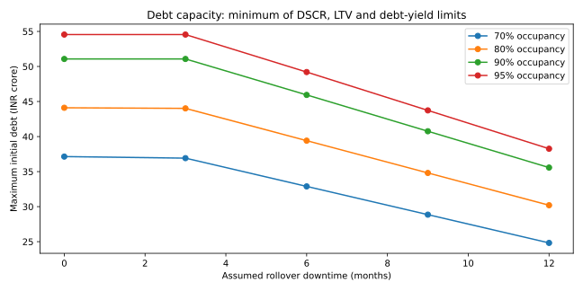

# Bengaluru Real Estate Investment Lab

## Investment question
What purchase price and debt amount can a hypothetical Bengaluru office acquisition support after lease downtime, capex and debt service? This combines acquisition underwriting with a separate SQL asset-management demonstration and an Embassy public-filings case. The synthetic office must not be confused with the Embassy asset.

## Mathematics and decisions
- Collected rent = occupied area × monthly rent × 12 − rollover area × monthly rent × downtime.
- NOI = collected rent − operating expenses. Equity operating cash = NOI − capex/reserves − debt service.
- Terminal gross value = next-year NOI / exit cap; sale proceeds deduct selling costs and remaining debt.
- NPV = Σ CF_t/(1+h)^t; all equity calls enter the equity multiple denominator. IRR is withheld where cash-flow signs imply ambiguous roots.
- Annuity factor a = r/[1−(1+r)^−n], or 1/n at zero interest.
- Debt capacity = min(price×LTV cap, minimum NOI/(DSCR floor×a), minimum NOI/debt-yield floor).
- Reverse underwriting bisects purchase price until both NPV≥0 and minimum DSCR≥1.25. Debt resizes at constant 55% LTV in this particular price screen.
- Input sensitivity uses [NPV(x×1.01)−NPV(x×0.99)]/2: currency change for a 1% relative input move, not a percentage elasticity.

## Results and investment conclusion
The assumed INR100 crore purchase fails the base screen: equity NPV is −INR11.00 crore and minimum DSCR is 1.04x. DSCR constrains initial debt to INR45.94 crore, below the INR55 crore proposed loan. At constant 55% LTV, the maximum passing price is INR83.53 crore. These are model thresholds, not observed asset values or an actual offer.

20 occupancy/downtime combinations show how rollover risk changes borrowing capacity. Existing analysis adds 3 scenarios, 25 rent/cap sensitivities, 25 financing sensitivities and 2,000 conditional stress draws. The operating module tracks 4 synthetic assets and 20 leases with exact NOI attribution, WALE and concentration.



## Audit map
`model.py` cash-flow engine; `investment_committee.py` financing and price tests; `asset_management/` SQL operations; `embassy_case/` public-filings memo, workbook and independent checks; `docs/BASE_METHODOLOGY.md` complete inherited assumptions. 16 investment tests plus 11 operating tests. Native desktop Excel sensitivity-table verification remains pending; Python reconciliation is not equivalent to native Excel validation.

## Limits and diligence
Single synthetic rollover, annual timing, no taxes/financing fees/lease-by-lease cash-flow model in the acquisition engine. Monte Carlo distributions are assumed, not calibrated. Lender constraints are illustrative. An actual decision needs rent roll, lease abstracts, technical capex, market comparables, legal/title diligence and lender terms. Existing Embassy evidence remains dated as documented in its memo.

## Evidence and interpretation

All generated inputs are assumptions, not empirical observations. Historical experiments are retrospective research, not a live track record. No employer sponsorship or investment recommendation is implied. Code was developed with AI assistance; the candidate must be able to reproduce, explain and modify it in interviews.

Source names, URLs and access dates are recorded in results JSON and the inherited methodology. Raw vendor price data are not redistributed. Use a lawfully obtained local CSV to reproduce historical runs; the default run is fully offline and synthetic.

## Reproduce and test

Python 3.12:
```bash
python -m pip install -r requirements.txt
python reproduce.py
```
GitHub Actions runs the same research entry point. Historical caches are deliberately excluded from CI. Generated CSVs are the audit trail; SVG figures are derived from those CSVs or the same in-memory results.
